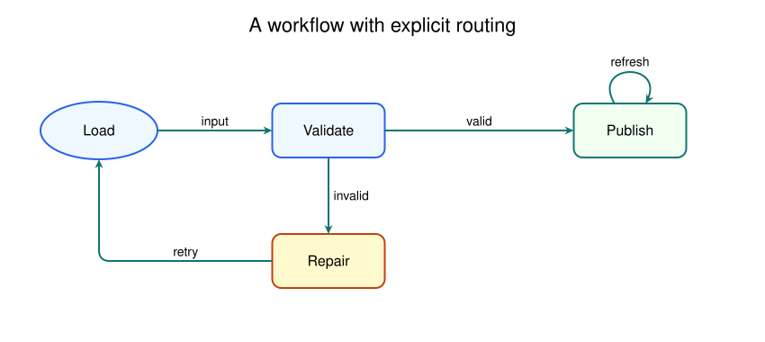

# SvgFlow documentation

SvgFlow builds editable SVG drawings from Python. Use `Canvas` for free-form
illustrations, `Plot` for two-dimensional charts, `Figure` for subplot grids,
and `Flow` for diagrams with named nodes and connected edges. All four share
the drawing, typography, gradient, import, and export methods of `Canvas`.

This guide describes the implementation in this repository (version 0.2.0).
It includes complete runnable examples, smaller recipes, generated figures,
and a reference extracted from the source signatures and docstrings.



## Learn the library

| Guide | What you will learn |
| --- | --- |
| [Getting started](getting-started.md) | Installation, first SVG, choosing a class, coordinate conventions |
| [Drawing and paths](drawing.md) | Shapes, layering, arrows, Bezier curves, arcs, gradients |
| [Text and fonts](text-and-fonts.md) | Alignment, multiline labels, wrapping, font metrics and registration |
| [Plotting](plotting.md) | Lines, scatter, bars, axes, ticks, legends, annotations and layout |
| [Figures and subplots](figures.md) | Grids, spanning cells, ratios, common styles, cross-panel annotations |
| [Flow diagrams](flow-diagrams.md) | Node shapes, styles, curved edges, ports, elbow routing and loops |
| [Composition, LaTeX and export](composition-and-export.md) | Importing SVGs, math, external programs, PNG/PDF output |
| [Recipes](recipes.md) | Data bands, grouped/stacked bars, thresholds, category labels, reusable assets |
| [Troubleshooting and limits](troubleshooting.md) | Common errors, surprising defaults, viewer differences, unsupported features |
| [Maintenance](maintenance.md) | Rebuilding examples/reference and checking documentation |

Read the first guide, then choose the topic matching your project. Each topic
links to the exact API reference. Examples use keywords where positional order
is easy to confuse, especially `height` before `width`.

## API reference

| Reference | Scope |
| --- | --- |
| [Canvas](api/canvas.md) | Every primitive, text, gradients, imports and output method |
| [Plot and PlotStyle](api/plot.md) | Plotting methods, layout parameters and style defaults |
| [Figure](api/figure.md) | Grid construction and coordinate conversion |
| [Flow and FlowStyle](api/flow.md) | Nodes, edges, routing and diagram style defaults |
| [Fonts and external helpers](api/helpers.md) | All other package exports and supporting font APIs |

## Run the examples

From a source checkout with SvgFlow installed:

```bash
python docs/examples/gallery.py
python docs/examples/recipes.py
```

The [gallery script](examples/gallery.py) writes the figures used throughout
the guides to `docs/figures/`. The [recipe script](examples/recipes.py) writes
additional examples there. Both work without Inkscape or LaTeX. See
[optional integrations](examples/optional_integrations.py) for examples that
need external programs and [maintenance](maintenance.md) for verification.

Figures are SVG assets generated by SvgFlow itself, with white backgrounds for
readability in light and dark Markdown viewers. Ordinary canvases are transparent.

## Conventions at a glance

| Concept | Convention |
| --- | --- |
| Constructor dimensions | `Canvas(height, width)`, likewise `Plot`, `Flow`, `Figure` |
| SVG coordinates | Origin at top-left; x right, y down |
| Units | SVG user units, normally CSS pixels |
| Angles | Degrees, clockwise from +x |
| Shape fill vs stroke | `color` / `border` for shapes; `color` / `fill` for paths |
| Text | Centered by default; XML escaped by `addText` |
| Drawing order | Later calls appear above earlier calls |
| Plot coordinates | Series and ticks use data; inherited primitives use canvas coordinates |
| Node coordinates | Every node position is its center |
| Output | `toSvg()` returns a string; `save()` writes SVG; `export()` uses Inkscape |

[Back to repository README](../README.md)
