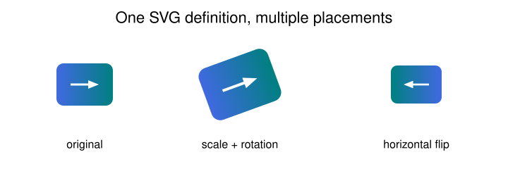

# SVG composition, LaTeX, and export

[Documentation home](README.md) · [Canvas reference](api/canvas.md) · [Helper reference](api/helpers.md)

## Import a reusable SVG

Import once under a unique ID, then place transformed copies:

```python
from svgflow import Canvas

# Create a self-contained asset first; it has a viewBox automatically.
icon = Canvas(80, 100)
icon.addRectangle(60, 80, 10, 10, color="royalblue", border="none", corner_radius=10)
icon.addLine(30, 40, 70, 40, color="white", thickness=3, directed=True)
icon.save("icon.svg")

c = Canvas(240, 720)
c.importSvgFromFile("icon.svg", fig_id="icon")
c.addSubFig("icon", 120, 120)
c.addSubFig("icon", 340, 120, scale=1.3, rot=-20)
c.addSubFig("icon", 590, 120, scale=0.9, flip=True)
c.save("composite.svg")
```



The default placement centers the imported viewBox rectangle on `(x, y)`.
`anchor="start"/"middle"/"end"` selects left/center/right, and
`baseline="hanging"/"middle"/"text-top"` selects top/center/bottom before
rotation. `rot` is clockwise degrees. `flip=True` mirrors horizontally in the
asset's local coordinates before rotation. Blank viewBox margins affect alignment;
trim the source SVG if you want alignment to the visible artwork.

The importer reads UTF-8 and requires a root `viewBox` with four whitespace
separated numbers and an explicit closing `</svg>` tag. It extracts inner
markup rather than deriving dimensions from `width`/`height`. For an existing
SVG lacking a viewBox, add an appropriate one in your SVG editor first.

Definitions are reused via `<use>`. Duplicate figure IDs raise `KeyError`;
placing an unknown ID raises `KeyError`. IDs and supported internal references
are prefixed during import to reduce collisions.

This is a lightweight markup importer, not a complete SVG normalization engine.
Keep imported SVGs self-contained: relative images/fonts are not copied or
rebased, root-only styles/attributes are not fully transferred, and arbitrary
CSS selector references are not rewritten. Prefer explicit presentation
attributes and internal definitions. Importing does not sanitize markup;
only inline SVG from sources you trust into web pages.

## Lower-level import helpers

```python
from svgflow import import_svg_from_file

inner, view_box = import_svg_from_file("icon.svg", fig_num="example")
min_x, min_y, width, height = view_box
```

This returns the inner fragment and numeric viewBox, with internal IDs prefixed
using `figexample`. It does not register a drawable subfigure on a canvas.
Use `Canvas.importSvgFromFile()` for that. The implementation helper
`svgflow.external_figures.uniquify_svg_ids()` rewrites declared `id`, `href`,
`xlink:href`, and `url(#id)` references using regular expressions; it is not a
general XML/CSS parser. If calling it directly, pass a unique explicit prefix.

## Configure external commands

Core SVG generation uses no external program. Other operations require:

| Operation | External requirements |
| --- | --- |
| `save`, `toSvg`, SVG import, ordinary text | None |
| PNG/PDF `export` | Inkscape |
| `addLaTeX`, `tex2svg`, any `latex=True` label | pdflatex plus selected conversion backend |
| `backend="inkscape"` | Inkscape |
| `backend="dvisvgm"` | dvisvgm with PDF input support |
| `backend="pdf2svg"` | pdf2svg |

The TeX template uses the `standalone` document class with 5pt border and
`amsmath`/`amssymb` packages. Ensure your TeX installation includes them.
No `mutool` command is used by the current implementation.

By default, command names are resolved on the subprocess `PATH`. To use
explicit paths, create an immutable `ExecutablePaths` value:

```python
from svgflow import Canvas, ExecutablePaths

tools = ExecutablePaths(
    inkscape=r"C:\Program Files\Inkscape\bin\inkscape.exe",
    pdflatex=r"C:\texlive\2025\bin\windows\pdflatex.exe",
    dvisvgm=r"C:\texlive\2025\bin\windows\dvisvgm.exe",
    pdf2svg=r"C:\tools\pdf2svg.exe",
)
c = Canvas(300, 600, executables=tools)
```

Replace paths with your installation locations. Supply the executable itself,
without shell quotes, flags, or a containing directory. `Plot`, `Flow`, and
`Figure` take the same keyword; figure subplots inherit it. Only the programs
needed by an operation are invoked. Setting paths does not validate or install
them. To check command resolution independently:

```python
import shutil
print(shutil.which("inkscape"))
print(shutil.which("pdflatex"))
```

## Add math labels

```python
from svgflow import Canvas

c = Canvas(220, 600)
c.addLaTeX(r"e^{i\pi}+1=0", 300, 70, scale=2, color="navy")
c.addLaTeX(r"\frac{1}{\sqrt{2\pi}}e^{-x^2/2}", 300, 150,
            scale=1.6, backend="inkscape")
c.save("equations.svg")
```


This pre-rendered illustration can be regenerated with the optional `latex`
example; viewing it does not require TeX or Inkscape.

Use raw Python strings for backslashes and omit `$...$`; the library wraps
the expression in display-style math. `scale` multiplies converter dimensions,
not a font size; the flow/plot helpers use approximately `text_size/16` as a
convenience scale. `rot`, `anchor`, and `baseline` align the rendered bounding
rectangle as with a subfigure. Math alignment uses the converter's viewBox,
including the template border, rather than an optical equation baseline.

For plots and diagrams:

```python
from svgflow import Plot, Flow

p = Plot(340, 600, x_range=(0, 5), y_range=(0, 1))
p.easyAxes()
p.addAxisLabels(r"t", r"P(X\leq t)", xlatex=True, ylatex=True)
p.addTitle(r"F_X(t)", latex=True)
p.save("math-plot.svg")

f = Flow(240, 600)
f.addNode("a", 100, 120, shape=("circle", 40), label=r"x_0", latex=True)
f.addNode("b", 480, 120, shape=("circle", 40), label=r"x_1", latex=True)
f.addEdge("a", "b", label=r"f(x)", latex=True, directed=True)
f.save("math-flow.svg")
```

These convenience methods use the default Inkscape math backend. For a
different backend or explicitly colored plot math labels, call `addLaTeX`
at mapped coordinates yourself. Plain `addText()` does not parse TeX.

Each math call launches pdflatex and a converter in a fresh temporary directory;
there is no expression cache. Large numbers of math labels can be slow. Reuse
an exported self-contained math SVG as an imported subfigure when appropriate.
The API accepts math source, not arbitrary preamble or full document options.

Lower-level conversion is also exported:

```python
from svgflow import tex2svg

inner, width, height = tex2svg(r"\sum_{k=1}^{n} k", eq_num=42, backend="dvisvgm")
# inner excludes the outer svg tag; internal IDs use an eq42 prefix.
```

Choose unique equation numbers if manually composing multiple fragments.
Missing commands raise `FileNotFoundError`; nonzero subprocess exits become
`RuntimeError`. Unsupported backends raise `ValueError` after TeX compilation.
There is no subprocess timeout parameter; use valid, trusted math inputs and
verify your TeX toolchain with the opt-in example before larger jobs.

## Save SVG and export PNG/PDF

```python
from pathlib import Path
from svgflow import Canvas

out = Path("output")
out.mkdir(exist_ok=True)
c = Canvas(300, 600)
c.addRectangle(300, 600, 0, 0, color="white", border="none")
c.addText("Publication figure", 300, 150, size=26)
c.save(out / "figure.svg")
c.export(out / "figure.png", export_type="png", dpi=300)
c.export(out / "figure.pdf", export_type="pdf")
```

`save()` always writes SVG, regardless of filename suffix. `export()` always
uses the explicit `export_type`, which defaults to `"png"`; a `.pdf` suffix
alone does not switch formats. Supported types are png and pdf. DPI applies
only to PNG (default 200). It changes raster resolution rather than canvas
coordinates; PDF remains vector where the SVG content allows it.

`export()` writes a temporary SVG internally, so saving first is optional.
It includes subplots/imports/definitions and removes temporary source files
after conversion. Existing destination files can be overwritten; parent
directories must exist. Transparent canvas areas stay transparent in SVG and
normally PNG; explicitly draw a background when you need a white raster or
page. PDF transparency/background handling also depends on the output viewer.

## Fonts during export

Saved SVGs embed used file-backed fonts with `@font-face` when requested.
Inkscape font resolution instead uses fontconfig. SvgFlow locates its base
configuration, creates a temporary font directory with registered faces and
registry-name aliases, and passes a private environment to the Inkscape
subprocess. This does not install fonts or modify your global environment.

If the base configuration cannot be located, export emits a warning and uses
the inherited environment. Registered fonts may then be substituted. When
investigating this, inspect `FONTCONFIG_FILE`, `FONTCONFIG_PATH`, and whether
your configured Inkscape executable belongs to a complete installation.
If a registered face was not supplied for a requested weight/style, synthesis
or fallback may still differ across viewers. See [text and fonts](text-and-fonts.md).

Run the complete [optional integration examples](examples/optional_integrations.py)
with `export` or `latex --backend inkscape`; they write only under `docs/figures/`.
