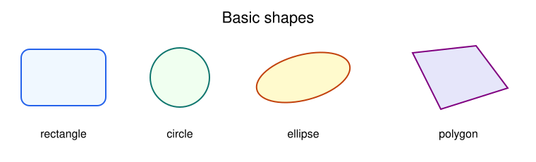
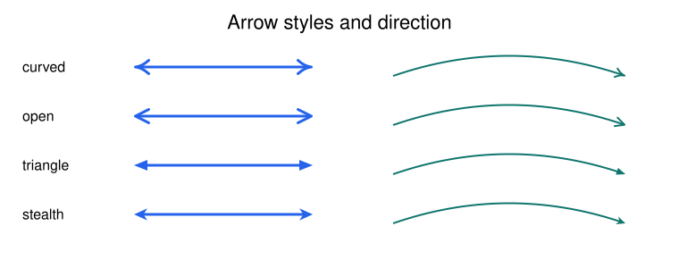
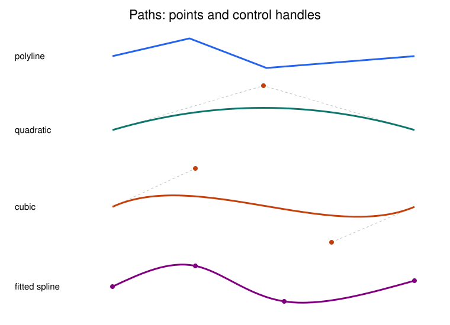
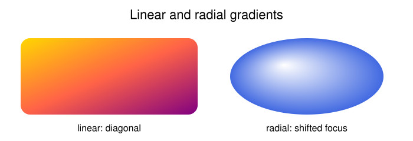

# Drawing, paths, arrows, and gradients

[Documentation home](README.md) · [Canvas reference](api/canvas.md)

## Basic shapes

`Canvas` accumulates vector elements in drawing order. The examples below use
one canvas; save it after adding the elements you want:

```python
from svgflow import Canvas

c = Canvas(height=300, width=760)
c.addRectangle(300, 760, 0, 0, color="white", border="none")
c.addRectangle(80, 120, 30, 70, color="aliceblue", border="royalblue",
               thickness=2, corner_radius=12)
c.addCircle(255, 110, radius=42, color="honeydew", border="teal", thickness=2)
c.addEllipse(430, 110, a=68, b=32, color="lemonchiffon",
             border="darkorange", rotation=-15)
c.addPolygon([(585, 75), (675, 65), (720, 125), (625, 155)],
             color="lavender", border="purple", thickness=2)
c.save("shapes.svg")
```



| Method | Geometry | Position/rotation reference |
| --- | --- | --- |
| `addRectangle(height, width, x, y, ...)` | Width and height are full dimensions | Local top-left; rotation about that corner |
| `addCircle(x, y, radius, ...)` | Radius in user units | Center |
| `addEllipse(x, y, a, b, ...)` | Horizontal and vertical radii before rotation | Center; rotation about center |
| `addPolygon(points, ...)` | Vertices in order, automatically closed | Absolute canvas points |

For these methods `color` means fill and `border` means outline. Use
`thickness` to change outline width, `opacity` for transparency, and `"none"`
to disable either fill or outline. Most methods pass paint strings straight
through to SVG; valid CSS hex and rgb colors work as well as named colors.

There is no general transform stack. Compute transformed points yourself or
compose a reusable [subfigure](composition-and-export.md) when you need to
move/rotate a group of elements together.

## Straight and curved labeled connections

```python
from svgflow import Canvas

c = Canvas(300, 600)
angle = c.addLine(50, 90, 550, 90, color="royalblue", thickness=3,
                  directed=True, label="straight connection", text_size=16)
control = c.addCurvedLine(50, 230, 550, 230, curvature=130,
                          color="teal", thickness=3, directed="both",
                          label="curved connection", label_gap=0.6)
print(angle)    # 0 degrees for a line from left to right
print(control)  # (300, 100): control point, not curve midpoint
c.save("connections.svg")
```

`addLine()` returns the line angle. `addCurvedLine()` returns its quadratic
control point. Its `curvature` is a **control-point offset** from the chord
midpoint, measured perpendicular to the chord in user units. The actual
midpoint of the quadratic curve moves half as far. Positive curvature bends
a horizontal line upward and a vertical line right; negative values reverse
the bend. This side convention does not simply mean “left of travel.”

Labels follow the connection's overall angle and are kept approximately
upright. `label_gap` is a multiple of `text_size` for ordinary text. Use
newlines or a list for multiple lines. `latex=True` invokes the math renderer;
it needs [external tools](composition-and-export.md).

## Arrowheads and dashes

Every stroked connection/path supports the same direction vocabulary:

| `directed` | Arrowheads |
| --- | --- |
| `False` | None |
| `True` or `"end"` | At the destination |
| `"start"` | At the source, pointing backward |
| `"both"` | At both ends |

Choose `arrow_style="curved"`, `"open"`, `"triangle"`, or `"stealth"`.
The default is curved. Set `canvas.arrow_style` to change future strokes
on that canvas, or override it on an individual method call.

```python
from svgflow import Canvas

c = Canvas(250, 600)
c.arrow_style = "stealth"
for i, style in enumerate(["curved", "open", "triangle", "stealth"]):
    c.addLine(60, 45 + i * 50, 530, 45 + i * 50,
              directed="both", arrow_style=style, thickness=3,
              dashed=(i == 1), color="royalblue")
c.addArrowhead(570, 210, angle=-90, arrow_style="triangle", arrow_size=1.3)
c.save("arrows.svg")
```



`arrow_size` is a multiplier, not a size in pixels. Head scale is
`arrow_size * max(1, thickness / 2)`; the base shape has length 10 units.
Keep sizes and thicknesses positive. Lines/curves are shortened to meet the
heads, and translucent strokes and heads are grouped to avoid dark overlap.
`dashed=True` emits a fixed SVG dash array of 4; custom dash patterns are not
exposed. A standalone head has its tip at `(x, y)` and points at `angle`.

## Polylines and explicit Bezier controls

Paths distinguish stroke `color` from interior `fill`:

```python
from svgflow import Canvas

c = Canvas(350, 700)
c.addLinePath([(40, 60), (180, 30), (310, 85)], color="royalblue", thickness=3)
c.addQuadraticPath(
    points=[(40, 160), (310, 160), (610, 160)],
    control_points=[(175, 50), (460, 250)],
    color="teal", thickness=3, directed=True,
)
c.addCubicPath(
    points=[(40, 290), (610, 290)],
    control_points_1=[(220, 150)],
    control_points_2=[(430, 340)],
    color="darkorange", thickness=3,
)
c.save("beziers.svg")
```



For `n` endpoints, supply `n-1` quadratic controls, or `n-1` controls in
**each** cubic list. Segment i runs from `points[i]` to `points[i+1]`.
The first cubic handle influences the departure direction and the second
the arrival direction. Controls generally do not lie on the drawn curve.
Counts that do not match raise `ValueError`; every path needs at least two
points. Explicit controls do not automatically ensure smooth joins.

`closed=True` on these three explicit path methods adds an SVG straight
closing segment. It does not invent a curved final segment. To make a closed
Bezier outline, repeat the first endpoint at the end and provide closing
controls. A `fill` on an open SVG path implicitly closes the interior for
painting, without adding a stroked closing edge.

## Fit a smooth spline through points

`addCurve()` computes cubic controls for you:

```python
from svgflow import Canvas

c = Canvas(300, 650)
c.addCurve([(30, 100), (170, 40), (300, 130), (580, 60)],
            color="purple", thickness=3)
c.addCurve([(100, 220), (180, 165), (290, 215), (200, 270)],
            closed=True, color="teal", fill="honeydew", thickness=2)
c.save("splines.svg")
```

Open curves need two or more points and use natural end conditions. Closed
curves need three or more points and use a periodic smooth seam; **do not
repeat the first point** for `addCurve(closed=True)`. The fitted spline has
continuous first and second derivatives at joins. It passes through the
input points but can overshoot between them; use a polyline for monotonic,
step-like, or bounded data where overshoot would mislead.

The fit solves a dense NumPy linear system. For large point sets, prefer
polylines, downsample smooth input, or supply your own Bezier controls.

## Circular arcs

```python
from svgflow import Canvas

c = Canvas(280, 600)
c.addCircularArc(150, 140, 80, theta1=200, theta2=340,
                 color="royalblue", thickness=3, directed=True)
c.addCircularArc(430, 140, 80, theta1=20, theta2=-200,
                 color="teal", thickness=3, directed="both")
c.save("arcs.svg")
```

Angle zero points right; 90 points down. Increasing angles sweep clockwise.
An arc uses one SVG `A` command; keep the requested sweep below a complete
revolution. Use `addCircle()` or two half-arcs for a full circle. Arc fills
close with a chord; they are not pie sectors from the center.

## Linear and radial gradients

Define a paint once, then retrieve its reference:

```python
from svgflow import Canvas

c = Canvas(240, 700)
c.defineLinearGradient(
    "sunset", x1=0, y1=0, x2=1, y2=1,
    stop_points=(0, 0.5, 1), stop_colors=("gold", "tomato", "purple"),
)
c.defineRadialGradient(
    "glow", cx=0.5, cy=0.5, fx=0.35, fy=0.35, r=0.5,
    stop_points=(0, 1), stop_colors=("white", "royalblue"),
    stop_opacities=(1, 0.85),
)
c.addRectangle(130, 300, 35, 65, color=c.getGradient("sunset"), border="none")
c.addEllipse(520, 130, 130, 65, color=c.getGradient("glow"), border="none")
c.save("gradients.svg")
```



Coordinates and stop offsets are fractions in `[0, 1]` of the painted
object's bounding box, not absolute canvas positions. Thus one gradient
stretches independently to each shape. A radial gradient on an ellipse or
rectangle scales with that object's bounding box. Order stops by increasing
offset. Provide at least two stops and matching color/opacity counts.

IDs are unique per canvas; integer `1` and string `"1"` name the same
gradient. Unknown IDs and duplicate definitions raise `KeyError`.
`spread_method` accepts `pad`, `reflect`, and `repeat`, but the current
implementation does not emit `spreadMethod`; all use the SVG default `pad`.
Do not rely on reflected or repeated spread in this version.

Next: [Text and fonts](text-and-fonts.md) or [plotting](plotting.md).
