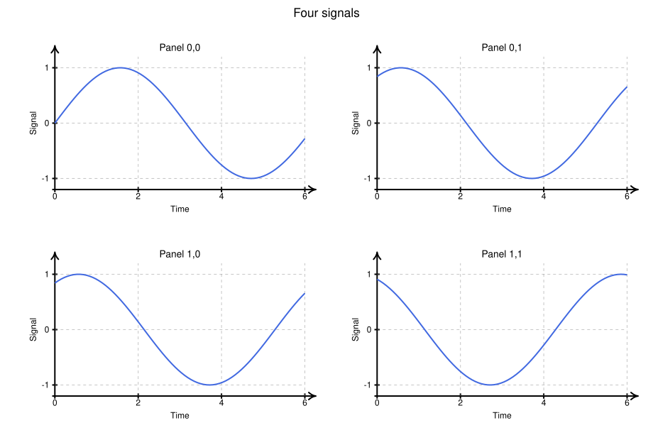
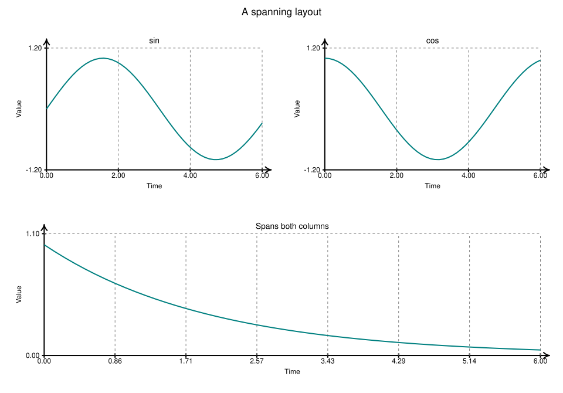
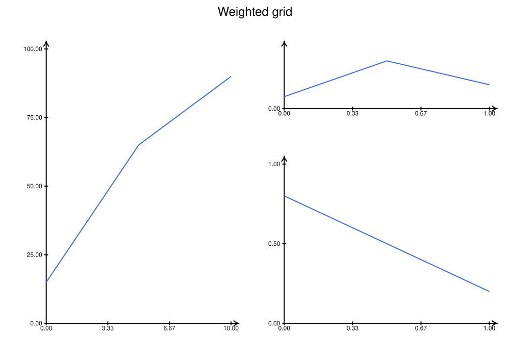
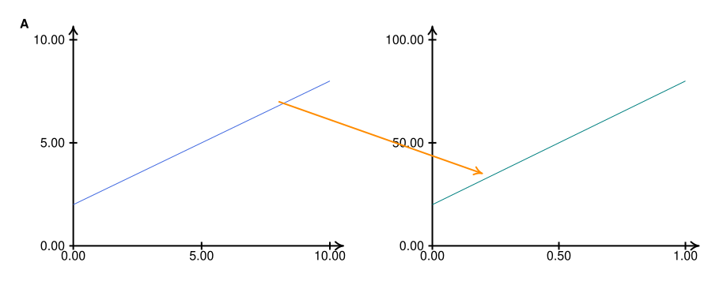
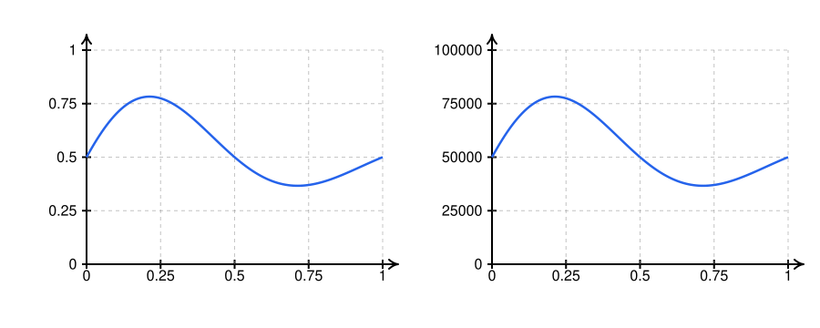

# Figures and subplots

[Documentation home](README.md) · [Figure reference](api/figure.md)

`Figure` divides a canvas into a grid and composes ordinary `Plot` objects.
Grid positions use zero-based `(row, col)` indexing, top to bottom and left
to right. Each plot has its own data ranges and local canvas coordinates.

## A regular grid

<!-- render: core -->
```python
import numpy as np
from svgflow import Figure, PlotStyle

fig = Figure(height=620, width=920, rows=2, cols=2,
             title="Four signals", style=PlotStyle.scaled(12),
             wspace=20, hspace=25, padding=16)
axes = fig.subplots(x_range=(0, 6), y_range=(-1.2, 1.2))
x = np.linspace(0, 6, 80)
for row in range(2):
    for col in range(2):
        ax = axes[row][col]
        ax.easyAxes(grid=True)
        ax.addPlot(x, np.sin(x + row + col), color="royalblue", thickness=2)
        ax.addAxisLabels("Time", "Signal")
        ax.addTitle(f"Panel {row},{col}")
fig.save("four-signals.svg")
```



Use `subplots()` on an empty grid. It fills every cell and returns a nested
list even for a single row/column. It is not an array with special squeezing
rules. Repeating it attempts to create overlapping plots and raises an error.

## Spanning rows or columns

Call `subplot()` yourself when panels have different ranges or spans:

<!-- render: core -->
```python
import numpy as np
from svgflow import Figure, PlotStyle

fig = Figure(670, 960, rows=2, cols=2, title="A spanning layout",
             style=PlotStyle.scaled(12), wspace=25, hspace=30, padding=18)
x = np.linspace(0, 6, 50)
left = fig.subplot(0, 0, x_range=(0, 6), y_range=(-1.2, 1.2))
right = fig.subplot(0, 1, x_range=(0, 6), y_range=(-1.2, 1.2))
wide = fig.subplot(1, 0, colspan=2, x_range=(0, 6), y_range=(0, 1.1))
for ax, y, title in [(left, np.sin(x), "sin"), (right, np.cos(x), "cos"),
                      (wide, np.exp(-x / 2), "Spans both columns")]:
    ax.easyAxes(grid=True)
    ax.addPlot(x, y, color="teal", thickness=2)
    ax.addAxisLabels("Time", "Value")
    ax.addTitle(title)
fig.save("spanning.svg")
```



The wide plot owns both lower cells. A later `fig.subplot(1, 1)` would raise
`ValueError`, rather than overlaying a second plot. Invalid spans raise
`ValueError`; out-of-grid positions/spans raise `IndexError`. There is no
subplot removal/replacement API. Keep the plot you receive and draw on it.

## Ratios, gaps, padding, and titles

<!-- render: core -->
```python
import numpy as np
from svgflow import Figure, PlotStyle

fig = Figure(700, 1000, rows=2, cols=3,
             width_ratios=[2, 1, 1], height_ratios=[1, 2],
             wspace=24, hspace=30, padding=20,
             title="Weighted grid", title_size=24,
             style=PlotStyle.theme("default", base_size=12))
def ticks(lo, hi, n):
    """Evenly spaced (value, label) tick pairs with tidy labels."""
    return [(v, f"{v:g}") for v in np.linspace(lo, hi, n)]


t = np.linspace(0, 10, 200)
main = fig.subplot(0, 0, rowspan=2, x_range=(0, 10), y_range=(0, 100))
top = fig.subplot(0, 1, colspan=2, x_range=(0, 10), y_range=(-1.2, 1.2))
bottom = fig.subplot(1, 1, colspan=2, x_range=(0, 10), y_range=(0, 1.1))
for ax, y, title, yticks in [
        (main, 100 * (1 - np.exp(-t / 3)), "Saturating growth", ticks(0, 100, 5)),
        (top, np.sin(2 * t) * np.exp(-t / 8), "Decaying oscillation", ticks(-1, 1, 5)),
        (bottom, np.exp(-((t - 5) / 1.6) ** 2), "Gaussian pulse", ticks(0, 1, 5))]:
    ax.addAxes(directed=True, thickness=2)
    ax.addTicksX(ticks(0, 10, 6))
    ax.addTicksY(yticks)
    ax.addPlot(t, y, thickness=2.5)
    ax.addTitle(title)
fig.save("weighted-grid.svg")
```



Ratios divide the space **after** subtracting padding, gaps and the optional
title band. They must be positive with exactly one entry per column/row.
`wspace` and `hspace` are user units between whole subplot canvases, not
percentages of the data area. A span includes internal gaps in its allocated
width/height. The figure title consumes a band above the grid; its default
font size is `1.25 * style.title_size`. Its band is established at construction.

`cellBox(row, col, rowspan=1, colspan=1)` returns
`(x, y, width, height)` in figure coordinates without creating or occupying
anything. Use it to place panel letters, backgrounds, or non-plot annotations.

## Three coordinate systems

1. Data coordinates belong to one `Plot`.
2. Local canvas coordinates describe that plot's full rectangle, including margins.
3. Figure coordinates describe the whole composed image.

`ax.mapToCanvas()` converts data to local canvas. `fig.mapToFigure(ax, x, y)`
converts subplot data directly to figure coordinates. With `data=False`, it
instead converts local canvas coordinates:

<!-- render: core -->
```python
import numpy as np
from svgflow import Figure, PlotStyle

fig = Figure(380, 900, rows=1, cols=2, style=PlotStyle.scaled(13))
a = fig.subplot(0, 0, x_range=(0, 10), y_range=(0, 10))
b = fig.subplot(0, 1, x_range=(0, 1), y_range=(0, 100))
def ticks(lo, hi, n):
    """Evenly spaced (value, label) tick pairs with tidy labels."""
    return [(v, f"{v:g}") for v in np.linspace(lo, hi, n)]


for ax, xt, yt in [(a, ticks(0, 10, 6), ticks(0, 10, 6)), (b, ticks(0, 1, 6), ticks(0, 100, 6))]:
    ax.addAxes(directed=True, thickness=2)
    ax.addTicksX(xt)
    ax.addTicksY(yt)
x = np.linspace(0, 10, 120)
u = np.linspace(0, 1, 120)
a.addPlot(x, 5 + 3 * np.sin(x / 1.5), thickness=2.5)
b.addPlot(u, 100 * (1 - np.exp(-5 * u)), thickness=2.5)
a.addTitle("Signal")
b.addTitle("Detail response")

start = fig.mapToFigure(a, 2.36, 8)
end = fig.mapToFigure(b, 0.3, 100 * (1 - np.exp(-1.5)))
fig.addLine(*start, *end, directed=True, color="#c2410c", thickness=2,
            arrow_style="stealth")
label_x, label_y = fig.mapToFigure(a, 15, 20, data=False)
fig.addText("A", label_x, label_y, weight="bold", anchor="start")
fig.save("linked-panels.svg")
```



A plot that does not belong to the figure raises `KeyError` when mapped.
Cross-panel arrows are ordinary canvas strokes; they are not clipped against
either plot. `fig.plots` returns all plots in creation order.

## Alignment and drawing order

Subplots inherit the figure's `PlotStyle`, current default font, current arrow
style, and executable configuration when created. Shared style **alone**
does not guarantee aligned data rectangles: automatic left margin estimates
also depend on y-range label widths. For exact alignment across very different
ranges, use the same explicit origin/right/top margins in equally sized cells:

<!-- render: core -->
```python
import numpy as np
from svgflow import Figure

fig = Figure(360, 900, rows=1, cols=2)
a = fig.subplot(0, 0, origin=(85, 280), margins=(25, 45), y_range=(0, 1))
b = fig.subplot(0, 1, origin=(85, 280), margins=(25, 45), y_range=(0, 100000))
u = np.linspace(0, 1, 120)
curve = 0.5 + 0.4 * np.sin(2 * np.pi * u) * np.exp(-1.5 * u)
for ax, values, top in [(a, curve, 1), (b, 100000 * curve, 100000)]:
    ax.addAxes(directed=True, thickness=2)
    ax.addTicksX([(v, f"{v:g}") for v in np.linspace(0, 1, 5)])
    ax.addTicksY([(v, f"{v:g}") for v in np.linspace(0, top, 5)])
    ax.addPlot(u, values, thickness=2.5)
fig.save("aligned.svg")
```



At each `subplot()` call, a placeholder is appended to the figure's drawing
order. Background elements added **before** subplot creation appear behind
the plots. Figure annotations added **after** subplot creation appear on top.
Later changes to a returned plot are included when the figure is saved again;
the placeholder holds the live plot, not a snapshot.

On rendering, each subplot's internal SVG IDs/references receive a unique
prefix so gradients, markers, and LaTeX glyphs from different panels coexist.
This renaming does not rewrite Python-side IDs or objects. `fig.save()` and
`fig.export()` use the complete composition; `ax.save()` writes that individual
plot in its own local dimensions.

Rebuild these exact examples with [render_examples.py](tools/render_examples.py);
[gallery.py](examples/gallery.py) contains additional annotated layouts.
