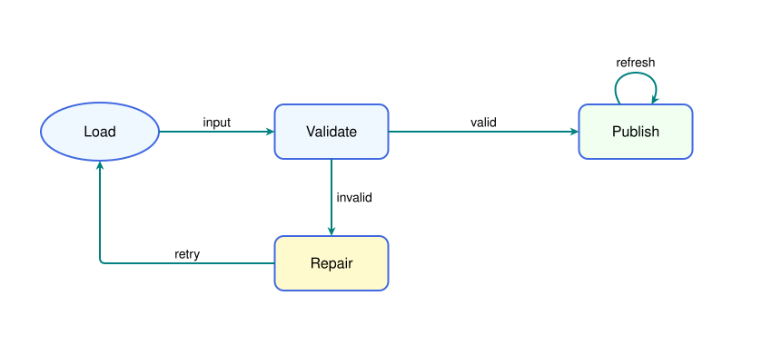
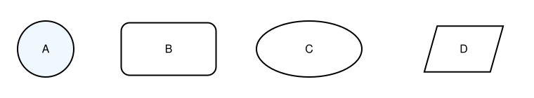
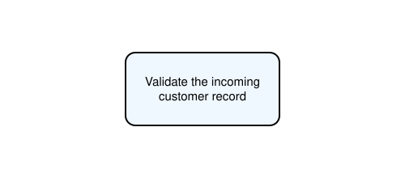
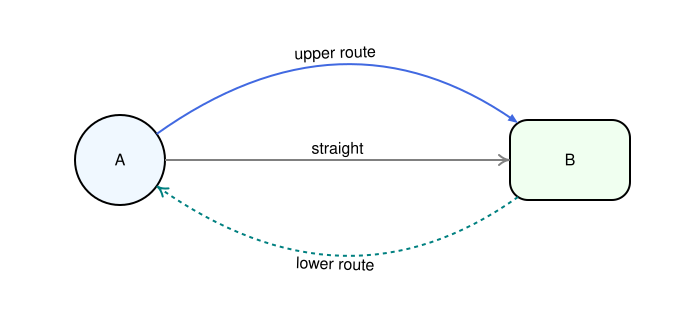
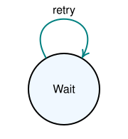
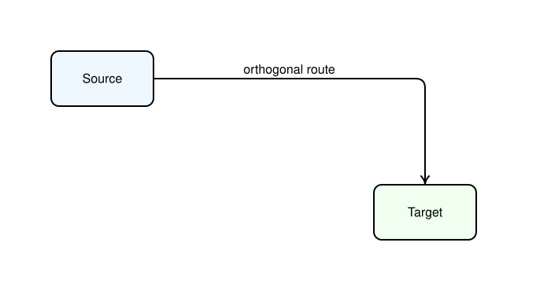
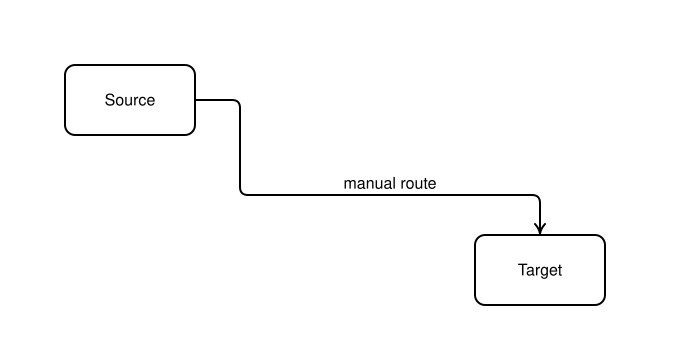
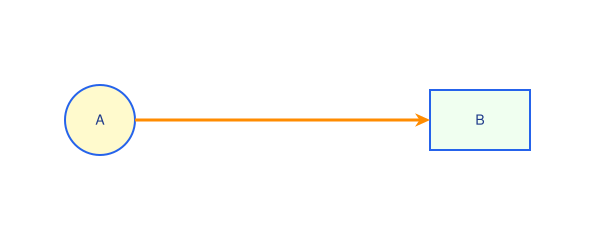

# Flow diagrams

[Documentation home](README.md) · [Flow / FlowStyle reference](api/flow.md)

`Flow` draws manually positioned nodes and connects their outlines. It has
straight, quadratic curved, self-loop and orthogonal edge helpers. It does
not choose node positions or avoid unrelated nodes automatically.

## Build a workflow

<!-- render: core -->
```python
from svgflow import Flow, FlowStyle

style = FlowStyle(
    node_shape=("rectangle", 60, 125, 10), node_color="aliceblue",
    node_border="royalblue", edge_color="teal", arrow_style="stealth",
    text_size=16, edge_text_size=14,
)
f = Flow(height=300, width=760, style=style)
f.addNode("load", 85, 100, shape=("ellipse", 65, 32), label="Load")
f.addNode("check", 310, 100, label="Validate")
f.addNode("done", 660, 100, label="Publish", color="honeydew")
f.addNode("repair", 310, 235, label="Repair", color="lemonchiffon")
f.addEdge("load", "check", directed=True, label="input")
f.addEdge("check", "done", directed=True, label="valid")
f.addElbowEdge("check", "repair", from_port="S", to_port="N", label="invalid")
f.addElbowEdge("repair", "load", from_port="W", to_port="S", label="retry")
f.addSelfEdge("done", theta1=240, theta2=300, curvature=70,
               directed=True, label="refresh")
f.save("pipeline.svg")
```



Create nodes before edges reference them. IDs identify nodes; labels are
display text and can repeat. Nodes stay where you put them. Later calls
paint above earlier calls, so keep intended crossings in mind. Edges meet
node outlines; they do not usually run under the node fill.

## Node shapes and center positions

Every node uses `(x, y)` as its **center**, including rectangular nodes.
Dimensions are canvas units:

| Shape tuple | Meaning |
| --- | --- |
| `("circle", r)` | Radius r |
| `("rectangle", h, w)` | Full height and width |
| `("rectangle", h, w, radius)` | Rounded rectangle |
| `("stadium", h, w)` | Pill shape (rounded rectangle with `radius = min(h, w) / 2`) |
| `("diamond", h, w)` | Rhombus / decision node of full height `h` and width `w` |
| `("ellipse", a, b)` | Horizontal radius a, vertical radius b |
| `("parallelogram", d1, d2, angle)` | Diagonal lengths and angle between diagonals in degrees |

<!-- render: core -->
```python
from svgflow import Flow

f = Flow(150, 860, background="white")
f.addNode("a", 55, 75, shape=("circle", 36), label="Circle", color="aliceblue")
f.addNode("b", 185, 75, shape=("rectangle", 68, 115, 10), label="Rect", color="honeydew")
f.addNode("c", 330, 75, shape=("stadium", 56, 115), label="Stadium", color="lavender")
f.addNode("d", 475, 75, shape=("diamond", 84, 125), label="Diamond", color="lemonchiffon")
f.addNode("e", 625, 75, shape=("ellipse", 62, 36), label="Ellipse", color="mistyrose")
f.addNode("p", 775, 75, shape=("parallelogram", 115, 90, 65), label="Skew", color="whitesmoke")
f.save("node-shapes.svg")
```



The old spelling `"paralellogram"` is accepted for compatibility; use
`"parallelogram"` in new code. Its arguments are diagonal lengths, **not**
width/height. Use nondegenerate diagonal/angle combinations; the implementation
does not comprehensively reject impossible geometry before doing square roots.

Duplicate node IDs raise `KeyError`; unsupported shape names raise `ValueError`.
There is no node-move/delete API. Mutating `flow.nodes` does not redraw the
already emitted node or its existing edges; regenerate the drawing instead.

## Labels and sizing

Node labels accept strings, newlines, or lists. Nodes do not resize or wrap
labels automatically. Use `wrap_text` when you want a paragraph-sized label:

<!-- render: core -->
```python
from svgflow import Flow, FlowStyle, wrap_text

style = FlowStyle(node_shape=("rectangle", 90, 190, 12), text_size=15)
f = Flow(130, 240, style=style)
lines = wrap_text("Validate the incoming customer record", 15, max_width=160)
f.addNode("validate", 120, 65, label=lines, color="aliceblue")
f.save("wrapped-node.svg")
```



Keep the measuring font/size consistent with the canvas default and node text
size. Labels use `text_color`, `text_size`, and optional `text_style` (e.g.
italic). `latex=True` treats the label as a math expression, without dollar
delimiters, and requires [LaTeX tools](composition-and-export.md).
Node `opacity` affects the shape; the separately drawn label remains opaque.

## Straight and curved edges

<!-- render: core -->
```python
from svgflow import Flow

f = Flow(320, 700)
f.addNode("a", 120, 160, shape=("circle", 45), label="A", color="aliceblue")
f.addNode("b", 570, 160, shape=("rectangle", 80, 120, 18), label="B", color="honeydew")
f.addEdge("a", "b", directed=True, label="straight", color="gray")
f.addEdge("a", "b", curvature=160, directed=True,
           label="upper route", color="royalblue", arrow_style="triangle")
f.addEdge("b", "a", curvature=-160, directed=True,
           label="lower route", color="teal", dashed=True)
f.save("curved-edges.svg")
```



Positive curvature moves the quadratic control upward for a horizontal chord
and rightward for a vertical one. The control offset is measured from the
midpoint of node centers. Boundary attachment points are found in the
directions of that control; a new quadratic connects them through the control.
It is not an exact trim of the original center-to-center curve. Geometry
accounts for circle, ellipse, rectangle (including rounded corners), and
supported parallelogram outlines.

`addEdge()` defaults to `directed=False`. Explicitly pass `True` for a target
arrow, `"start"` for a source arrow, or `"both"` for both. Arrow styles and
scales work as in the [drawing guide](drawing.md). Missing node IDs raise
`KeyError`. Connecting a node to itself with `addEdge` also raises `KeyError`;
use `addSelfEdge`.

Edge labels are offset away from the line/curve with `style.label_gap` in
label-font multiples. Labels can be multiline and roughly follow the chord
angle. The code does not resolve collisions between labels, other edges, and
unrelated nodes. Use different curvature, positions, or a custom annotation.

## Self-loops

<!-- render: core -->
```python
from svgflow import Flow

f = Flow(195, 180)
f.addNode("state", 90, 125, shape=("circle", 50), label="Wait", color="aliceblue")
f.addSelfEdge("state", theta1=240, theta2=300, curvature=110,
               directed=True, label="retry", color="teal")
f.save("loop.svg")
```



`theta1` is the outgoing attachment angle, `theta2` the returning one.
Angles are clockwise from +x: E=0, S=90, W=180, N=270. Defaults 60 and 120
put a loop below the node. Use 240 and 300 for a loop above.
`curvature=None` uses `style.self_loop_size` (100 by default). Its sign is
ignored; loops bulge outward. For typical non-opposite attachments, the apex
lies about `abs(curvature)/2` beyond the attachment chord. Leave canvas space
for both the loop and its label. Self-loops default to no arrow.

## Ports and automatic elbow routing

`getPort(node, "N"/"S"/"E"/"W")` returns a boundary point in canvas coordinates.
Port names are case-insensitive. Ports are intersections of cardinal rays
from the center; for a parallelogram they need not be side midpoints.

<!-- render: core -->
```python
from svgflow import Flow, FlowStyle

f = Flow(360, 700, style=FlowStyle(node_shape=("rectangle", 70, 130, 10)))
f.addNode("source", 130, 100, label="Source", color="aliceblue")
f.addNode("target", 540, 270, label="Target", color="honeydew")
route = f.addElbowEdge(
    "source", "target", from_port="E", to_port="N",
    stub=25, corner_radius=12, label="orthogonal route",
)
print(route)  # simplified centerline points, before rounding/arrow shortening
print(f.getPort("source", "E"))
f.save("elbow.svg")
```



Without explicit ports, the dominant center displacement chooses facing
sides: predominantly horizontal pairs use E/W; predominantly vertical pairs
use S/N. `stub` controls the nominal straight departure/arrival space before
bending. The router handles facing, perpendicular, and same-side ports with
simple geometric rules; it does not search for obstacles. Tight geometry and
path simplification can reduce visibly distinct stub segments.

`corner_radius=0` creates sharp corners. Positive radii round bends and are
limited by available adjacent segment lengths. `addElbowEdge()` defaults to
**directed=True**, unlike the other edge methods.

## Manual waypoints and label segments

<!-- render: core -->
```python
from svgflow import Flow, FlowStyle

f = Flow(360, 700, style=FlowStyle(node_shape=("rectangle", 70, 130, 10)))
f.addNode("source", 130, 100, label="Source")
f.addNode("target", 540, 270, label="Target")
route = f.addElbowEdge(
    "source", "target", from_port="E", to_port="N",
    waypoints=[(240, 100), (240, 195), (540, 195)],
    label="manual route", label_segment="longest", corner_radius=8,
)
f.save("waypoints.svg")
```



A nonempty waypoint list overrides automatic routing. It is followed
**literally**: the library connects port -> waypoint -> ... -> port, without
inserting additional bends or stubs. Supply an axis-aligned route yourself.
If you omit ports, they are chosen to face the first and last waypoint.
`waypoints=[]` selects automatic routing.

Duplicate and collinear points are simplified. `label_segment="longest"`
chooses the longest simplified segment, or pass a zero-based segment index.
Indices refer to the **returned simplified route**, not the original waypoint
list. An invalid index can raise `IndexError` after the stroke is appended.
Horizontal segment labels appear above the segment; other segment labels
appear to its right. For a route needing arbitrary label placement, omit
`label` and use `addText` at a chosen canvas coordinate.

## FlowStyle defaults and overrides

| Fields | Defaults |
| --- | --- |
| `node_shape` | `("circle", 20)` |
| `node_color`, `node_border`, `node_thickness` | `"none"`, `"black"`, 2 |
| `text_size`, `text_color`, `text_style` | 16, `"black"`, `None` |
| `edge_color`, `edge_thickness` | `"black"`, 2 |
| `edge_text_size`, `edge_text_color` | `None` (follow node text defaults) |
| `label_gap` | 0.4 label-font units |
| `arrow_style`, `arrow_size` | `None` (canvas default), 1 |
| `stub`, `corner_radius` | 20, 6 canvas units |
| `self_loop_size` | 100 canvas units |

<!-- render: core -->
```python
from svgflow import Flow, FlowStyle

base = FlowStyle.theme("ocean", text_size=14)
accent = base.copy(node_color="lemonchiffon", edge_color="darkorange")
f = Flow(110, 435, style=accent)
f.addNode("a", 65, 55, label="A", shape=("circle", 35))
f.addNode("b", 355, 55, label="B", shape=("rectangle", 60, 100), color="honeydew")
f.addEdge("a", "b", directed=True, thickness=3)
f.save("styled-flow.svg")
```



`FlowStyle.theme(name, **overrides)` builds a style from a named color preset
in `FLOW_THEMES`: `"default"`, `"ocean"`, `"forest"`, `"sunset"`, `"slate"`,
`"lavender"`, or `"minimal"`.

Omitted/`None` style-controlled arguments use the style; per-call values
override it. Edge `text_style` is passed directly and does not inherit the
node `text_style` default. Styles govern future calls. Changing a style later
does not redraw existing elements. If you need to use the canvas arrow style,
leave `FlowStyle.arrow_style=None`; a non-None style takes priority.

See [gallery.py](examples/gallery.py) for the complete illustrated workflow.
