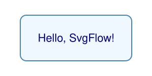
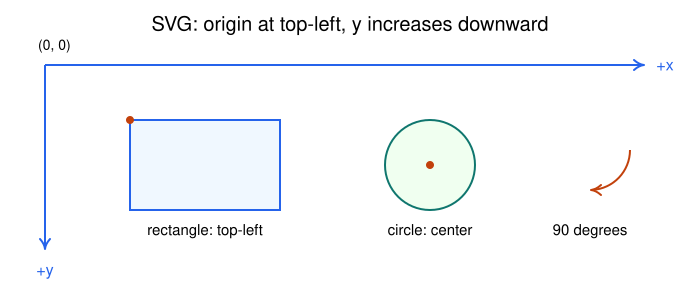
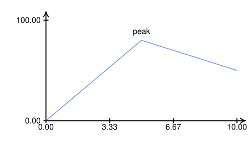
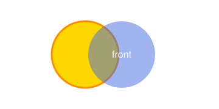
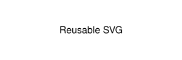

# Getting started

[Documentation home](README.md) · Next: [Drawing and paths](drawing.md)

## Install

SvgFlow requires Python 3.10+, NumPy 1.23+, and PyMuPDF 1.24.3+.
The package declares these Python dependencies, so pip installs them together:

```bash
python -m pip install svgflow
```

For the source checkout containing this guide, run from the repository root:

```bash
python -m venv .venv
# Activate on Windows PowerShell:
.venv\Scripts\Activate.ps1
# Or on macOS/Linux:
# source .venv/bin/activate
python -m pip install -e .
```

Check the interpreter and imported package if you have several Python installs:

```bash
python -c "import sys, svgflow; print(sys.executable); print(svgflow.__version__); print(svgflow.__file__)"
```

Basic SVG output needs no external executable. Inkscape is needed for
`export()`; `addLaTeX()` needs pdflatex and a PDF-to-SVG backend. You can learn
the core library before installing either. See [setup](composition-and-export.md).

## Your first drawing

Save this as `hello_svgflow.py` and execute it with Python:

```python
from pathlib import Path
from svgflow import Canvas

out = Path("output")
out.mkdir(exist_ok=True)

canvas = Canvas(height=150, width=300)
canvas.addRectangle(150, 300, 0, 0, color="white", border="none")
canvas.addRectangle(
    height=90, width=220, x=40, y=30,
    color="aliceblue", border="steelblue", thickness=2, corner_radius=12,
)
canvas.addText("Hello, SvgFlow!", x=150, y=75, size=22, color="navy")
canvas.save(out / "hello.svg")
```



Open `output/hello.svg` in a browser or SVG editor. The rectangle is a vector
shape and the label remains text. A white background is drawn explicitly;
omitting the first rectangle makes the canvas transparent.

`save()` overwrites a file and does not create its parent directory. It leaves
the drawing in memory, so you can add elements and save another version.

## Choose the right class

```python
from svgflow import Canvas, Plot, Figure, Flow

canvas = Canvas(300, 500)                        # free-form drawing
plot = Plot(300, 500, x_range=(0, 10), y_range=(0, 100))
figure = Figure(600, 900, rows=2, cols=2)        # plots in a grid
flow = Flow(300, 500)                           # connected named nodes
```

`Plot`, `Figure`, and `Flow` inherit from `Canvas`. You can use text, shapes,
paths, gradients, imported SVGs, LaTeX, and output methods on any of them.
`Figure.subplot()` returns a `Plot`; its drawing is composed into the figure
when the figure is rendered. There is no automatic graph layout in `Flow`.

## Understand coordinates before drawing

For a `Canvas(240, 480)`, `(0, 0)` is the upper-left and `(480, 240)` the
lower-right. Positive y points down. A 90-degree rotation points downward.



Most dimensions use the same user units as coordinates. For example, a 16-unit
font on a 480-unit-wide canvas occupies the same relative scale regardless of
the browser's display size. SVG resizing scales the entire drawing.

Shapes use different reference points:

```python
from svgflow import Canvas, Flow

c = Canvas(200, 400)
c.addRectangle(60, 100, 20, 30)  # top-left (20,30), bottom-right (120,90)
c.addCircle(220, 60, 30)          # center (220,60), radius 30
c.addEllipse(320, 60, 45, 20)     # center, horizontal/vertical radii

f = Flow(200, 400)
f.addNode("box", 200, 100, shape=("rectangle", 60, 100))
# Node rectangle is centered at (200,100), top-left (150,70).
```

On a `Plot`, data and drawing coordinates are separate:

<!-- render: core -->
```python
from svgflow import Plot

p = Plot(300, 500, x_range=(0, 10), y_range=(0, 100))
p.easyAxes()
p.addPlot([0, 5, 10], [0, 80, 50])  # data coordinates
cx, cy = p.mapToCanvas(5, 80)
p.addText("peak", cx, cy - 18)      # canvas coordinates
p.save("peak.svg")
```



The y direction reverses during data mapping, so larger data y values appear
higher in an ordinary plot. Inherited `addLine`/`addCircle`/`addText` methods
do not automatically map data coordinates.

## Paint and layering

Later elements paint above earlier ones. Draw backgrounds first, then grids,
data, annotations, and legends. A path's `color` is its stroke, whereas a
rectangle's `color` is its fill:

<!-- render: core -->
```python
from svgflow import Canvas

c = Canvas(180, 360)
c.addRectangle(180, 360, 0, 0, color="white", border="none")
c.addCircle(140, 90, 55, color="gold", border="darkorange", thickness=3)
c.addCircle(200, 90, 55, color="royalblue", border="none", opacity=0.5)
c.addText("front", 200, 90, color="white")
c.save("layers.svg")
```



Use valid SVG colors such as `"steelblue"`, `"#2563eb"`, or `"rgb(40,90,160)"`.
`"none"` disables fill/stroke. Drawing methods generally emit paint strings
directly; they do not consistently validate every input. Keep IDs simple
(letters, digits, underscores, hyphens) and unique within their namespace.

## Strings, files, and interactive use

<!-- render: core -->
```python
from svgflow import Canvas

c = Canvas(70, 200)
c.addText("Reusable SVG", 100, 35)
svg_markup = c.toSvg()
assert svg_markup.startswith("<svg")
c.save("reusable.svg")
```



In a Jupyter notebook with IPython installed:

```python
from IPython.display import SVG, display
display(SVG(c.toSvg()))  # continues the previous example
```

`toSvg()` does not write files or clear state. There is no automatic display
hook, undo stack, or scene-object editing API. Keep the Python drawing code
as the reproducible source for later changes.

Continue with [drawing primitives](drawing.md), [plots](plotting.md), or
[flow diagrams](flow-diagrams.md). The [API reference](api/canvas.md) lists
every supported argument and its default.
