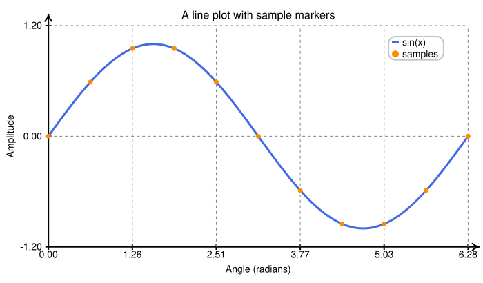
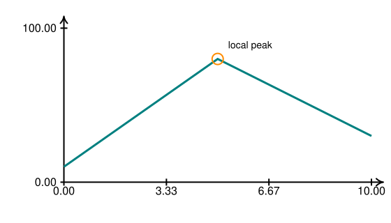
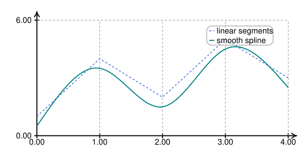
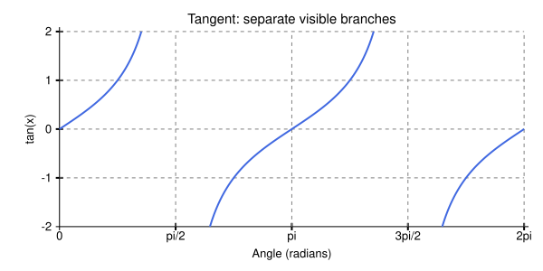
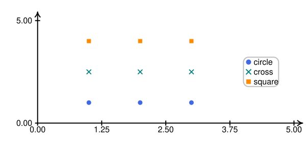
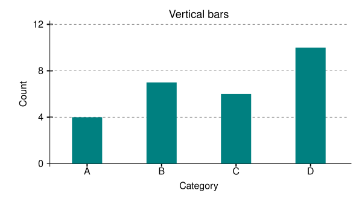
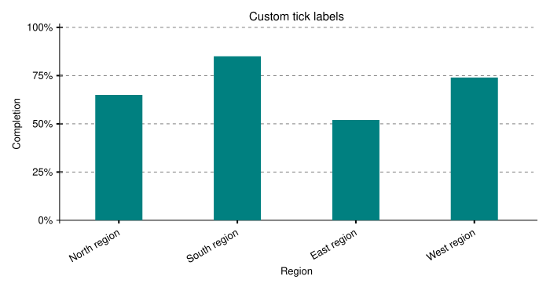
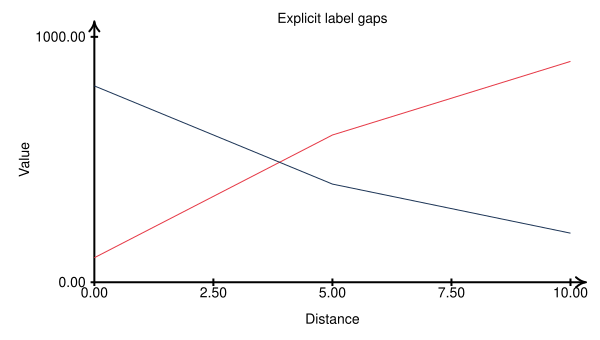
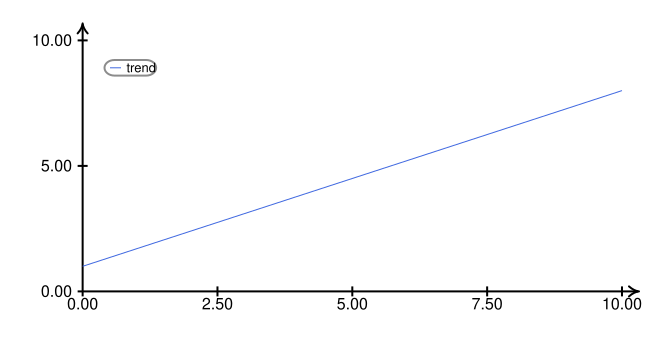

# Plotting data

[Documentation home](README.md) · [Plot / PlotStyle reference](api/plot.md)

## A complete line and scatter plot

<!-- render: core -->
```python
import numpy as np
from svgflow import Plot, PlotStyle

x = np.linspace(0, 2 * np.pi, 81)
p = Plot(height=410, width=700, x_range=(0, 2 * np.pi),
         y_range=(-1.2, 1.2), style=PlotStyle.scaled(14))
p.easyAxes(grid=True)
p.addPlot(x, np.sin(x), color="royalblue", thickness=3, label="sin(x)")
p.addScatterPlot(x[::8], np.sin(x[::8]), color="darkorange",
                 marker_type="circle", marker_scale=0.7, label="samples")
p.addAxisLabels("Angle (radians)", "Amplitude")
p.addTitle("A line plot with sample markers")
p.addLegend(anchor="NE", box_color="white", box_border_color="silver", box_opacity=0.95)
p.save("sine.svg")
```



Choose ranges explicitly; data does not autoscale them. Draw axes/grid first,
then series, then labels and annotations, and finally the legend. Each call
adds elements; calling `easyAxes()` twice creates two sets of axes and ticks.

## Data coordinates and canvas coordinates

The data rectangle runs from `(xmin, ymin)` to `(xmax, ymax)`. For increasing
ranges, its lower-left maps to `(O_x, O_y)` and upper-right to
`(width - m_x, m_y)`, where `O_x/O_y` locate the plot origin and `m_x/m_y`
are right/top margins. Mapping is linear in each direction.

| Method | Input coordinates or dimensions |
| --- | --- |
| `addPlot`, `addScatterPlot`, `addBarPlot`, `addBar` | Positions/heights in data coordinates |
| `addTicksX`, `addTicksY` | Tick values in data coordinates |
| `mapToCanvas` | Data in, canvas coordinates out |
| `putMarker(..., on_canvas=True)` | Data positions (despite the argument name) |
| `putMarker(..., on_canvas=False)` | Raw canvas positions |
| Inherited `addText`, `addCircle`, `addLine`, paths, polygons | Raw canvas coordinates |
| Bar widths, marker sizes, strokes, fonts, padding overrides | Canvas units (marker sizes are multipliers) |

<!-- render: core -->
```python
from svgflow import Plot

p = Plot(320, 560, x_range=(0, 10), y_range=(0, 100))
p.easyAxes()
p.addPlot([0, 5, 10], [10, 80, 30], color="teal", thickness=3)
cx, cy = p.mapToCanvas(5, 80)
p.addCircle(cx, cy, 8, color="none", border="darkorange", thickness=2)
p.addText("local peak", cx + 15, cy - 20, anchor="start", size=14)
p.save("annotated.svg")
```



Values outside the declared ranges extrapolate beyond the plot area. There
is no plot-area clip path, NaN segmentation, or automatic filtering. Filter
data or split lines yourself before plotting. Equal range endpoints cause
division by zero; use distinct finite endpoints. SVG still has its outer
viewport, but that does not protect tick/label margins from out-of-range data.

## Lines and interpolation

`addPlot(x, y)` joins paired values in input order. It does not sort x:

<!-- render: core -->
```python
from svgflow import Plot

p = Plot(330, 600, x_range=(0, 4), y_range=(0, 6))
p.easyAxes(grid=True)
p.addPlot([0, 1, 2, 3, 4], [1, 4, 2, 5, 3],
           color="royalblue", thickness=2, dashed=True, opacity=0.8,
           label="linear segments")
p.addPlot([0, 1, 2, 3, 4], [0.5, 3.5, 1.5, 4.5, 2.5],
           color="teal", thickness=2, interp=True, label="smooth spline")
p.addLegend(box_color="white", box_border_color="gray")
p.save("interpolation.svg")
```



`interp=True` uses the cubic spline described in [drawing](drawing.md).
It interpolates points, rather than fitting a statistical model, and can
overshoot between samples. At least two paired values are required.
For step plots, create repeated x/y pairs yourself; there is no `step=` option.

Inputs are consumed with Python `zip`. If lengths differ, unmatched trailing
values are ignored. Check lengths in your data pipeline if that would hide
a mistake. Generators work but are consumed once; create fresh iterators for
each series or convert them to arrays/lists first.

## Discontinuous functions

`addPlot()` connects every adjacent pair in a call; it does not detect poles
or split at NaN/infinity. Clamping `tan(x)` to the y range produces false flat
segments and lines across its asymptotes. Split the continuous branches and
sample only the portion of each branch inside the visible range:

<!-- render: core -->
```python
import numpy as np
from svgflow import Plot, PlotStyle

p = Plot(300, 600, x_range=(0, 2 * np.pi), y_range=(-2, 2),
         style=PlotStyle.scaled(13))
p.addAxes()
p.addTicksX([(0, "0"), (np.pi / 2, "pi/2"), (np.pi, "pi"),
             (3 * np.pi / 2, "3pi/2"), (2 * np.pi, "2pi")])
p.addTicksY([(-2, "-2"), (-1, "-1"), (0, "0"), (1, "1"), (2, "2")])
# tan(x) is in [-2, 2] on these three intervals within [0, 2*pi].
# The poles at pi/2 and 3*pi/2 lie in the gaps between them.
limit = np.arctan(2)
intervals = [(0, limit), (np.pi - limit, np.pi + limit),
             (2 * np.pi - limit, 2 * np.pi)]
for left, right in intervals:
    x = np.linspace(left, right, 80)
    p.addPlot(x, np.tan(x), color="royalblue", thickness=2)
p.addAxisLabels("Angle (radians)", "tan(x)")
p.addTitle("Tangent: separate visible branches")
p.save("discontinuous.svg")
```



The gaps contain values outside the displayed y range and the poles. No stroke
connects one branch to another. For missing observations in general datasets,
see the [finite-segment recipe](recipes.md#split-a-series-around-missing-values).

## Scatter markers

<!-- render: core -->
```python
from svgflow import Plot

p = Plot(300, 600, x_range=(0, 5), y_range=(0, 5))
p.easyAxes()
for marker, y, color in [("circle", 1, "royalblue"), ("cross", 2.5, "teal"),
                         ("square", 4, "darkorange")]:
    p.addScatterPlot([1, 2, 3], [y] * 3, marker_type=marker,
                     marker_scale=0.9, color=color, label=marker)
p.addLegend(anchor="E", box_color="white", box_border_color="gray")
p.save("markers.svg")
```



Circle radius is `5 * marker_scale`; square side is `9 * marker_scale`;
cross span is `10 * marker_scale` user units. Sizes remain fixed as data ranges
change. These are the only supported marker shapes. Unknown shapes raise
`ValueError`. Scatter does not expose a per-call opacity or per-point sizes;
use separate calls or primitives when you need those variations.

## Bars and baselines

<!-- render: core -->
```python
from svgflow import Plot

p = Plot(330, 600, x_range=(-0.5, 3.5), y_range=(0, 12))
p.addAxes()
p.addTicksX([(0, "A"), (1, "B"), (2, "C"), (3, "D")], grid=False)
p.addTicksY([(0, "0"), (4, "4"), (8, "8"), (12, "12")])
p.addBarPlot([0, 1, 2, 3], [4, 7, 6, 10], bar_width=50, color="teal", label="count")
p.addAxisLabels("Category", "Count")
p.addTitle("Vertical bars")
p.save("bars.svg")
```



`bar_width` is in **canvas units**, not x data units. To convert a desired
data width, subtract mapped x positions:

```python
# Continues with p from the previous example.
width_in_data = 0.6
width_in_canvas = abs(p.mapToCanvas(width_in_data, 0)[0] - p.mapToCanvas(0, 0)[0])
```

`addBar(x, y, bar_width, _y=0)` draws one bar from baseline `_y` to top `y`.
`addBarPlot(..., _y=None)` instead uses the lower y-range endpoint as the
baseline. Supplying `_y=[...]` gives per-bar baselines; the `y` input remains
the absolute top coordinate, not a component height. See the
[stacked/grouped recipes](recipes.md).

The current bar implementation emits `height=canvas_baseline-canvas_top`
directly. Keep each top at or above its baseline for increasing y ranges.
Negative/downward bars are not normalized; see the recipe for a manual
rectangle workaround. There are no horizontal bar, histogram or boxplot
helpers; you can build them with primitives.

## Automatic and manual ticks

`easyAxes()` draws axes plus `easyTicks()`. Its defaults include directed
axes, thickness 2, and no grid. `easyTicks()` uses about 0.01 ticks per canvas
unit and formats values with two decimal places. Density is clamped between
0.005 and 0.05; counts are computed from the plotted pixel/user-unit extent,
not the numeric data range. It uses `linspace`, not “nice number” intervals.

Each axis gets `round(axis_length * ticks_per_unit)` labels, including both
endpoints when the count is at least two. A 221-unit axis therefore gets only
two labels at the default density. Increase the density, for example with
`easyAxes(ticks_per_unit=0.025)`, to get six labels on that axis. The
minimum-range endpoint is labeled but has no notch, so two labels leave just
one visible tick mark. `PlotStyle.scaled()` does not change tick density.

Manual ticks take `(data_position, displayed_label)` pairs:

<!-- render: core -->
```python
from svgflow import Plot, PlotStyle

p = Plot(380, 700, x_range=(-0.5, 3.5), y_range=(0, 100),
         style=PlotStyle.scaled(13), extra_margins=(0, 50, 0, 0))
p.addAxes()
p.addTicksX(list(enumerate(["North region", "South region", "East region", "West region"])),
             rotation=-30, grid=False)
p.addTicksY([(0, "0%"), (25, "25%"), (50, "50%"), (75, "75%"), (100, "100%")])
p.addBarPlot([0, 1, 2, 3], [65, 85, 52, 74], color="teal", bar_width=60)
p.addAxisLabels("Region", "Completion")
p.addTitle("Custom tick labels")
p.save("custom-ticks.svg")
```



Manual tick methods default to `grid=True`, unlike `easyAxes`/`easyTicks`.
The minimum-range endpoint gets a label but no notch/grid line. Labels can
be multiline. Rotated x labels anchor at their end for negative rotation or
their start for positive rotation; use `text_anchor` to override.
`notch_length` is the total tick length centered on the axis. `pad` overrides
the notch-end-to-label gap in canvas units.

## Axis labels, titles, and spacing

Call `addAxisLabels()` **after ticks**: it uses the measured tick extents.
The y label rotates -90 degrees by default; `yrot` is added to that rotation.
`xrot` is the x-label rotation. Optional `xlatex`, `ylatex` and `latex` on
titles invoke external math rendering. In this version the `color` argument
is used for plain labels/titles; their LaTeX branches render in the default
black. Use `addLaTeX()` directly for explicitly colored math annotations.

`PlotStyle` defines consistent size and spacing defaults:

| Field | Default | Unit / meaning |
| --- | --- | --- |
| `tick_size` | 16 | Tick label font size |
| `label_size` | 16 | Axis label font size |
| `title_size` | 18 | Title font size |
| `tick_length` | 10 | Total notch length in canvas units |
| `tick_pad` | 0.35 | Notch-end gap as a multiple of tick size |
| `label_pad` | 0.5 | Tick-label-to-axis-label gap as a multiple of label size |
| `title_pad` | 0.6 | Plot-top-to-title gap as a multiple of title size |
| `outer_pad` | 8 | Automatic layout outer border in canvas units |
| `line_height` | 1.2 | Text extent and margin estimate multiplier |
| `axis_gap` | 6 | Clearance between the plot boundary and the back of an axis arrowhead (or undirected axis end) in canvas units |
| `palette` | `"default"` | Series color cycle (preset name in `PALETTES` or sequence of color strings) |

<!-- render: core -->
```python
from svgflow import Plot, PlotStyle

style = PlotStyle.theme("vibrant", base_size=12, label_pad=0.65, outer_pad=12)
larger = style.copy(tick_size=14, label_size=14)
p = Plot(340, 600, style=larger, x_range=(0, 10), y_range=(0, 1000))
p.easyAxes()
p.addPlot([0, 5, 10], [100, 600, 900], label="series 1")  # auto-assigned from palette
p.addPlot([0, 5, 10], [800, 400, 200], label="series 2")  # shifts to next palette color
p.addAxisLabels("Distance", "Value", xpad=35, ypad=70)
p.addTitle("Explicit label gaps", pad=14)
p.save("spacing.svg")
```



When `color` is omitted (`None`) on `addPlot()`, `addScatterPlot()`, or
`addBarPlot()`, the plot automatically assigns the next color from
`style.palette` via `p.nextColor()` (and `p.resetColors()` resets the cycle).
Explicitly passing `color=...` uses that color without advancing the automatic
cycle. Built-in palette presets in `PALETTES` (`PlotStyle.theme(name, ...)` or
`PlotStyle(palette=name)`) are `"default"`, `"vibrant"`, `"pastel"`,
`"colorblind"`, `"ocean"`, `"warm"`, and `"monochrome"`.

`scaled(base)` sets ticks/labels to base, title to `1.15*base`, notch
length to `0.625*base`, and `axis_gap` to `0.375*base` (rounded to two decimals). Gap fractions stay unchanged.
`copy()` derives a new style; using the same style instance in several plots
shares a mutable object. Later mutations affect future drawing calls, not
already emitted text or the layout estimated at construction.

Explicit `pad`/`xpad`/`ypad` values are canvas units. `xpad` measures from
the x-axis to the top of its label; `ypad` from the y-axis to the center line
of its rotated label. They are not identical geometric conventions.

## Automatic and explicit margins

Defaults are `origin="auto", margins="auto"`. Margins are estimated from
range endpoint label widths, style fonts, notch lengths and title space.
They are not a final pass that measures everything you later draw.
Long/custom/rotated labels need extra space:

```python
from svgflow import Plot

p = Plot(420, 700, x_range=(0, 10), y_range=(0, 100),
         extra_margins=(30, 50, 10, 15))  # left, bottom, right, top
```

Extra margins apply to the automatic part of the layout. Alternatively set
the bottom-left origin and right/top margins explicitly:

```python
from svgflow import Plot

p = Plot(400, 700, origin=(100, 310), margins=(30, 50),
         x_range=(0, 10), y_range=(0, 100))
legacy = Plot(400, 700, origin=None, margins=None)
# legacy: origin=(0.15*width, 0.85*height), margins=(0.10*width, 0.10*height)
```

Too-small auto layouts warn and fall back to percentages. Axis label calls
warn for some detected left/bottom overflow, but not every possible overlap
or rotation. Inspect the generated drawing. `tickExtent("x")`/`tickExtent("y")`
report the recorded outward tick-label extent in canvas units, falling back
to half a default notch before ticks are drawn.

## Legends

Add `label=` to series, then call `addLegend()`. At least one labeled series
is required. Entries are grouped by type: bar, line (`plot`), then scatter;
insertion order is preserved within each type. Repeated labels are not deduplicated.

Anchors are `NE`, `N`, `NW`, `W`, `E`, `SW`, `S`, `SE`, located inside the plot
with approximately 5% inset. For a custom position:

<!-- render: core -->
```python
from svgflow import Plot

p = Plot(350, 650, x_range=(0, 10), y_range=(0, 10))
p.easyAxes()
p.addPlot([0, 10], [1, 8], label="trend", color="royalblue", thickness=2)
p.addLegend(position=(110, 60), text_size=13, marker_scale=1.1,
             box_color="white", box_border_color="gray", box_opacity=0.9)
p.save("legend-position.svg")
```



Position is a canvas-space reference near the top-left; the box starts
`5*marker_scale` units left of its x value. It overrides an anchor. If using
`anchor=None`, provide a position. `box_opacity` affects the box only, so text
and symbols remain readable. The default box is yellow with a red outline at
0.5 opacity; specify a quieter style if desired. Legend marker sizes use the
legend's `marker_scale`, independently of the original scatter sizes.

Next: [Subplots](figures.md) and [practical recipes](recipes.md).
