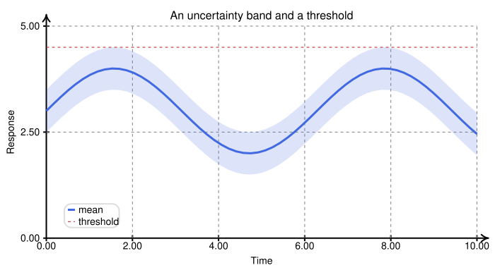
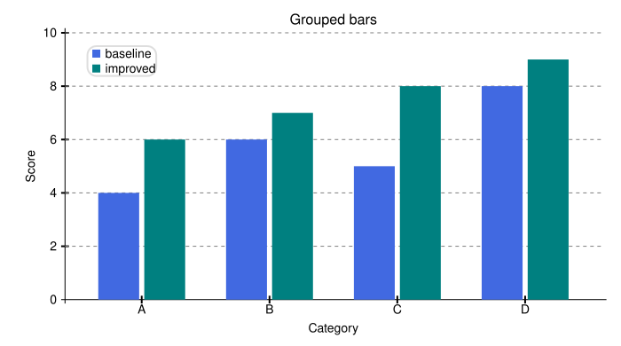
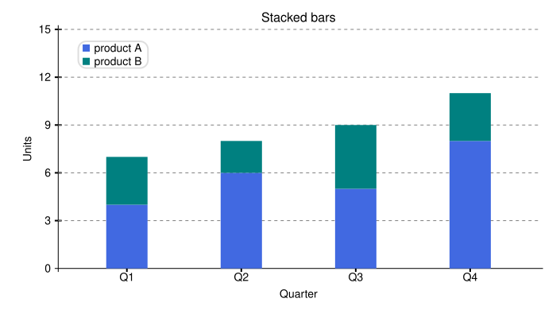
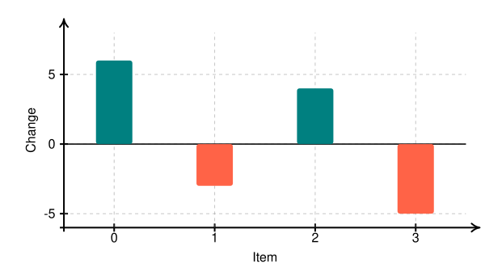
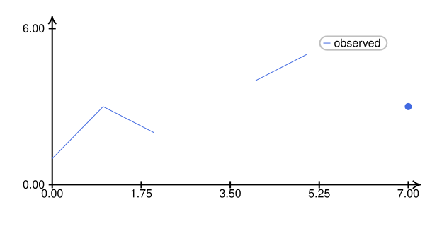
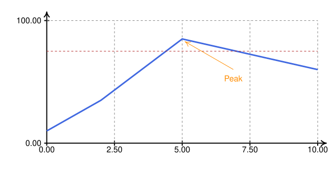
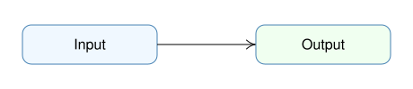

# Practical recipes

[Documentation home](README.md) · [Runnable recipe script](examples/recipes.py)

These recipes combine the public API rather than introducing new library
features. Each larger example can be adapted to your own arrays and styles.

## Shade an interval around a curve

Construct one polygon by traversing the upper edge left-to-right and the lower
edge right-to-left. Map the boundary to canvas space before drawing it:

<!-- render: core -->
```python
import numpy as np
from svgflow import Plot, PlotStyle

x = np.linspace(0, 10, 60)
mean = 3 + np.sin(x)
low, high = mean - 0.5, mean + 0.5
p = Plot(390, 700, x_range=(0, 10), y_range=(0, 5), style=PlotStyle.scaled(14))
p.easyAxes(grid=True)
boundary = list(zip(x, high)) + list(zip(x[::-1], low[::-1]))
p.addPolygon([p.mapToCanvas(a, b) for a, b in boundary],
              color="royalblue", border="none", opacity=0.18)
p.addPlot(x, mean, color="royalblue", thickness=3, label="mean")
p.addPlot([0, 10], [4.5, 4.5], color="firebrick", dashed=True, label="threshold")
p.addAxisLabels("Time", "Response")
p.addTitle("An uncertainty band and a threshold")
p.addLegend(anchor="SW", box_color="white", box_border_color="silver")
p.save("uncertainty.svg")
```



Draw the fill before the mean line to keep the stroke sharp. Polygon edges
are straight between samples, so sample densely enough for your purpose.
The interval is supplied by your analysis; SvgFlow does not compute confidence
intervals or uncertainty estimates. Custom polygons do not register a legend
entry automatically. This example labels only the mean and threshold.

## Grouped bars with widths in data units

Offset each group's x positions and convert a desired data width to canvas
units. One `addBarPlot` call gives one legend entry:

<!-- render: core -->
```python
import numpy as np
from svgflow import Plot, PlotStyle

p = Plot(390, 700, x_range=(-0.6, 3.6), y_range=(0, 10), style=PlotStyle.scaled(14))
p.addAxes()
p.addTicksX(list(enumerate(["A", "B", "C", "D"])), grid=False)
p.addTicksY([(i, str(i)) for i in range(0, 11, 2)])
x = np.arange(4)
width = abs(p.mapToCanvas(0.32, 0)[0] - p.mapToCanvas(0, 0)[0])
p.addBarPlot(x - 0.18, [4, 6, 5, 8], bar_width=width, color="royalblue", label="baseline")
p.addBarPlot(x + 0.18, [6, 7, 8, 9], bar_width=width, color="teal", label="improved")
p.addAxisLabels("Category", "Score")
p.addTitle("Grouped bars")
p.addLegend(anchor="NW", box_color="white", box_border_color="silver")
p.save("grouped.svg")
```



The 0.36 spacing between bar centers leaves a 0.04 data-unit gap between
bars of width 0.32. Recompute the canvas width if the plot dimensions or
mapping change.

## Stacked bars

The upper series needs absolute tops (`lower + upper`), with `_y=lower`:

<!-- render: core -->
```python
import numpy as np
from svgflow import Plot, PlotStyle

p = Plot(390, 700, x_range=(-0.6, 3.6), y_range=(0, 15), style=PlotStyle.scaled(14))
p.addAxes()
p.addTicksX(list(enumerate(["Q1", "Q2", "Q3", "Q4"])), grid=False)
p.addTicksY([(i, str(i)) for i in [0, 3, 6, 9, 12, 15]])
x = np.arange(4)
lower = np.array([4, 6, 5, 8])
upper = np.array([3, 2, 4, 3])
p.addBarPlot(x, lower, bar_width=52, color="royalblue", label="product A")
p.addBarPlot(x, lower + upper, _y=lower, bar_width=52, color="teal", label="product B")
p.addAxisLabels("Quarter", "Units")
p.addTitle("Stacked bars")
p.addLegend(anchor="NW", box_color="white", box_border_color="silver")
p.save("stacked.svg")
```



Do not pass component heights directly as the upper series's `y`, or it may
end below its baseline. For more stacks, maintain a cumulative total and
use the previous total as each new baseline.

## Bars that extend below a baseline

The built-in bars do not normalize negative SVG heights. For signed values,
map the endpoints and draw positive-height rectangles yourself:

<!-- render: core -->
```python
from svgflow import Plot

p = Plot(340, 600, x_range=(-0.5, 3.5), y_range=(-6, 8))
p.easyAxes(grid=True)
p.addPlot([-0.5, 3.5], [0, 0], color="black")
for x, value in enumerate([6, -3, 4, -5]):
    cx, baseline_y = p.mapToCanvas(x, 0)
    _, top_y = p.mapToCanvas(x, value)
    p.addRectangle(abs(top_y - baseline_y), 45, cx - 22.5,
                    min(top_y, baseline_y), color="teal" if value >= 0 else "tomato",
                    border="none")
p.addAxisLabels("Item", "Change")
p.save("signed-bars.svg")
```



These manual rectangles do not register legend entries. Axes still sit on the
plot boundaries; the separate zero line is an annotation.

## Split a series around missing values

Pass finite segments separately. This keeps gaps visible instead of connecting
across missing observations or emitting `nan` coordinates:

<!-- render: core -->
```python
import numpy as np
from svgflow import Plot

x = np.arange(8)
y = np.array([1, 3, 2, np.nan, 4, 5, np.nan, 3])
p = Plot(320, 600, x_range=(0, 7), y_range=(0, 6))
p.easyAxes()
run = []
labeled = False
for a, b in [*zip(x, y), (np.nan, np.nan)]:
    if np.isfinite(a) and np.isfinite(b):
        run.append((a, b))
        continue
    if len(run) >= 2:
        xs, ys = zip(*run)
        p.addPlot(xs, ys, color="royalblue", label=None if labeled else "observed")
        labeled = True
    elif run:
        p.addScatterPlot([run[0][0]], [run[0][1]], color="royalblue")
    run = []
if labeled:
    p.addLegend(box_color="white", box_border_color="gray")
p.save("gaps.svg")
```



The label is registered only once. Isolated finite observations are shown as
points because a line series needs at least two pairs.

## Annotate a threshold and point

<!-- render: core -->
```python
from svgflow import Plot

p = Plot(340, 650, x_range=(0, 10), y_range=(0, 100))
p.easyAxes(grid=True)
p.addPlot([0, 2, 5, 8, 10], [10, 35, 85, 70, 60], color="royalblue", thickness=3)
p.addPlot([0, 10], [75, 75], color="firebrick", dashed=True, label="limit")
px, py = p.mapToCanvas(5, 85)
p.addLine(px + 100, py + 60, px + 5, py + 5, directed=True, color="darkorange")
p.addText("Peak", px + 100, py + 78, color="darkorange")
p.save("point-annotation.svg")
```



An annotation's offset is in canvas units, so the label remains a sensible
distance from the point as you change data ranges.

## Make a reusable drawing function

<!-- render: core -->
```python
from svgflow import Canvas

def badge(canvas, label, x, y, color="aliceblue"):
    """Draw a fixed-size labeled badge on any Canvas subclass."""
    canvas.addRectangle(44, 150, x - 75, y - 22, color=color,
                         border="steelblue", corner_radius=10)
    canvas.addText(label, x, y, size=16)

c = Canvas(100, 460)
badge(c, "Input", 100, 50)
badge(c, "Output", 360, 50, color="honeydew")
c.addLine(175, 50, 285, 50, directed=True)
c.save("badges.svg")
```



This works for `Canvas`, `Flow`, `Plot` and `Figure`, because the function uses
only inherited canvas-space methods. For data-positioned badges on a plot,
convert their centers with `mapToCanvas()` before calling it. For reusable
artwork stored outside Python, use [SVG imports](composition-and-export.md).
