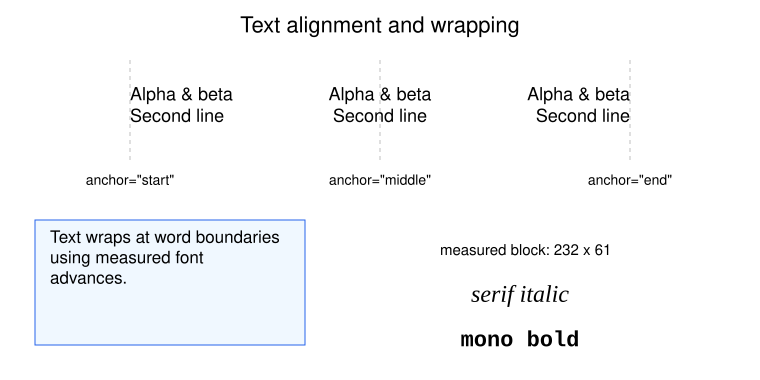

# Text, font metrics, and wrapping

[Documentation home](README.md) · [Canvas reference](api/canvas.md) · [Font reference](api/helpers.md)

## Single-line text

```python
from svgflow import Canvas

c = Canvas(240, 600)
width, height = c.addText(
    "Revenue < target & costs > plan", 300, 70,
    color="navy", size=20, weight="bold", font="sans",
)
c.addText("Rotated label", 300, 160, rotation=-20, style="italic", size=22)
c.save("labels.svg")
print(width, height)
```

`addText` converts values to strings and escapes XML text characters such as
`&` and `<`. Do not pre-escape labels. The return value is an unrotated
layout estimate: maximum line advance width and
`line_count * line_height * size` height. A single line at size 20 with the
default line height returns height 24; this is not a tight visible-glyph box.

`rotation` turns the text clockwise around `(x, y)`. Positive rotation tilts
rightward text down, negative rotation tilts it up. Text stays editable in SVG.
`weight="bold"` or a numeric weight at least 600 selects bold metrics;
`style="italic"` or `"oblique"` selects italic metrics. Other valid SVG
weight/style strings are written through, but metric selection remains this
simple bold/italic choice.

## Anchors and vertical placement

`anchor` sets which part of each line is at x:

| Anchor | Meaning |
| --- | --- |
| `"start"` | Left/start of text at x |
| `"middle"` | Center at x (default) |
| `"end"` | Right/end at x |

The common `baseline` choices are `"middle"` (default), `"hanging"` (top),
and `"text-top"`/`"auto"` (block grows upward for multiline positioning).
Actual glyph baseline rendering follows the SVG viewer; these are not exact
bounding-box alignments. For multiline text, `valign="top"`, `"center"`, or
`"bottom"` chooses the line-block growth independently of the per-line
baseline. It has no separate positioning effect on a single line.



```python
from svgflow import Canvas

c = Canvas(260, 600)
c.addText("Top aligned", 30, 30, anchor="start", baseline="hanging")
c.addText(["Centered block", "second line"], 300, 130)
c.addText("Right aligned", 570, 220, anchor="end", baseline="auto")
c.save("alignment.svg")
```

Each multiline line shares the same anchor x; short lines do not inherit the
longest line's left edge. Use `anchor="start"` for a left-aligned paragraph.

## Explicit lines and automatic wrapping

These two calls produce the same line content:

```python
from svgflow import Canvas

c = Canvas(300, 600)
c.addText("First line\nSecond line", 150, 80)
c.addText(["First line", "Second line"], 450, 80)
c.addText(
    "This paragraph wraps at word boundaries using the selected font's metrics.",
    30, 160, size=18, max_width=250, line_height=1.35,
    anchor="start", baseline="hanging",
)
c.save("multiline.svg")
```

`max_width` is in canvas units. Wrapping is greedy: it adds words until the
next word no longer fits. An individual long word remains intact and may
exceed the width. Explicit newlines survive, including empty paragraphs;
other whitespace inside each paragraph is normalized to single spaces.
There is no hyphenation or automatic font shrinking.

`addMultiLineText()` remains a compatibility wrapper. Prefer `addText()` for
new code; the wrapper is marked deprecated in its docstring but does not emit
a runtime deprecation warning. An empty list returns `(0, 0)` from the wrapper.

## Measure before positioning

```python
from svgflow import Canvas, text_width, wrap_text

label = "A measured label"
size = 18
width = text_width(label, size, font="sans", bold=True)
lines = wrap_text("A longer paragraph to wrap into lines.", size, max_width=180)

c = Canvas(220, 500)
c.addRectangle(60, width + 30, 30, 30, color="aliceblue", border="steelblue")
c.addText(label, 45, 60, anchor="start", size=size, weight="bold", font="sans")
c.addText(lines, 280, 120, anchor="start", baseline="hanging", size=size)
c.save("measured.svg")
```

`text_width()` measures one string's advance width. It does not split newline
blocks; measure each line and take the maximum yourself. Negative font sizes
raise `ValueError`; size zero is permitted. The `bold`/`italic` flags select
registered faces, so use the same flags as the drawing call.

`fit_width=True` writes `textLength` and `lengthAdjust="spacingAndGlyphs"`
for each line. This asks an SVG viewer to use the measured advance, useful
when consistent box/legend alignment matters. It may stretch glyphs if a
viewer substitutes a different font. Legends use it automatically.

## Built-in font families

```python
from svgflow import available_fonts
print(available_fonts())  # default, mono, sans, serif (sorted; custom fonts may appear)
```

| Registry name | Measured using | SVG fallback family |
| --- | --- | --- |
| `default`, `sans` | PyMuPDF Helvetica faces | Helvetica, Arial, sans-serif |
| `serif` | PyMuPDF Times faces | Times New Roman, Times, serif |
| `mono` | PyMuPDF Courier faces | Courier New, Courier, monospace |

These metric fonts need no font files. SVG viewers use the CSS family chain,
so actual built-in font rendering can differ from the measured face. For more
consistent output across viewers, register the actual font files you intend
to draw. Coverage for non-Latin scripts depends on the selected font; complex
script shaping and bidirectional layout are not provided by the metric helper.

## Register custom TTF/OTF fonts

This example requires your own font files at the shown paths:

```python
from svgflow import Canvas, register_font, text_width

register_font(
    "ReportSans", regular="fonts/ReportSans-Regular.ttf",
    bold="fonts/ReportSans-Bold.ttf", italic="fonts/ReportSans-Italic.ttf",
    bold_italic="fonts/ReportSans-BoldItalic.ttf",
    family="Report Sans, sans-serif", embed=True,
)
c = Canvas(220, 600)
c.default_font = "ReportSans"
c.addText("Registered font", 300, 80, size=26)
c.addText("Bold variant", 300, 140, size=22, weight="bold")
print(text_width("Registered font", 26, font="ReportSans"))
c.save("custom-font.svg")
```

The equivalent canvas convenience API is:

```python
from svgflow import Canvas

c = Canvas(200, 500)
c.registerFont("ReportSans", "fonts/ReportSans-Regular.ttf", make_default=True)
c.addText("Canvas default", 250, 100, size=24)
c.save("font.svg")
```

Registration is **process-wide**: other canvases can use the registry name.
`make_default=True` changes only that canvas's `default_font`. Re-registering
a name replaces its entry. Faces are validated immediately. Missing bold or
italic variants fall back toward regular; a viewer may synthesize a style,
which can differ from measurement. Supply all used variants for best results.

Only used font families are emitted in saved SVG CSS. With `embed=True`,
file-backed faces are base64-embedded through `@font-face`; saved files can
be much larger. Built-in PyMuPDF faces are never embedded. With `embed=False`,
the browser must find a suitable installed family. Ensure you have the right
to embed any font you distribute.

Inkscape export handles registered files with a temporary fontconfig
configuration because Inkscape does not use the embedded CSS in the same
way. See [export behavior](composition-and-export.md) for details.

## Text in plots and flows

Set `PlotStyle` sizes before constructing a plot; automatic margins use those
sizes. A `Figure` copies its current default font into newly created plots
before computing their margins. Changing a standalone plot's default font
after construction does not recompute margins; reserve explicit room when
using substantially different fonts or long custom tick labels.

`Flow` node labels accept lists/newlines, but nodes do not grow to fit them.
To wrap a node label, call `wrap_text()` yourself with the same font and size,
then pass the resulting list to `addNode()`. See the [flow guide](flow-diagrams.md).
